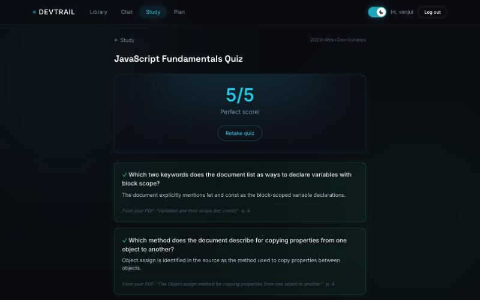
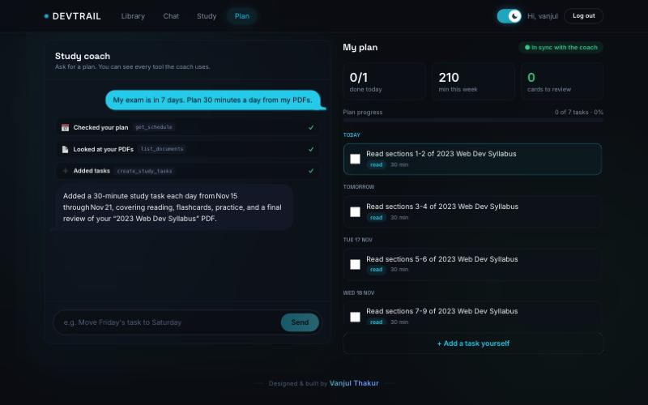
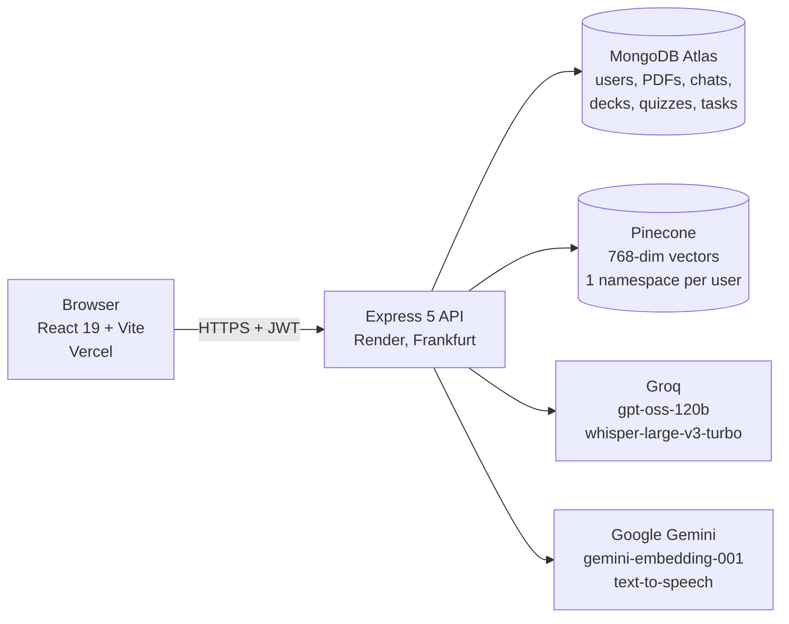
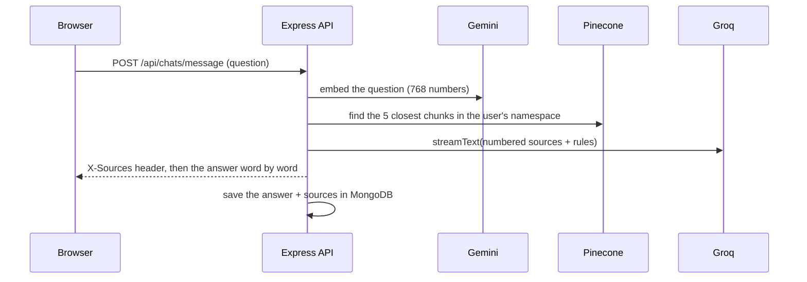

# DevTrail

**An AI study companion for developers.** Upload your own PDFs (docs, course notes, books) and DevTrail answers with page citations, makes flashcards and quizzes that must quote your PDF, talks out loud, and plans your study week with an agent that uses real tools.

Milestone 5 · Flavour B (Developer learning companion) · WSCube Full Stack Mentorship · by **Vanjul Thakur**

**Live:** https://devtrail-two.vercel.app · **API:** https://devtrail-api.onrender.com/api/health

> The API runs on Render's free plan and sleeps after 15 minutes. The first request after that can take about 50 seconds.

**Demo video (2–3 min):** _link coming soon_

### Test accounts

Two accounts, so you can check that each user only sees their own data.

| User | Email | Password |
| --- | --- | --- |
| A | `vanjul@tests.com` | `test12345` |
| B | _to be added_ | _to be added_ |


---

## Features

| Feature | What it does |
| --- | --- |
| **Library** | Upload PDFs (max 25 MB, about 600 pages of text). Each one is read page by page, cut into chunks and stored as vectors in your private space. |
| **RAG chat** | Answers only from your PDFs, streamed word by word, with clickable citations `[1]` that open the source text and page. Says *"I couldn't find this in your material."* instead of guessing. |
| **Flashcards & quizzes** | 10 cards or 5 questions from a PDF and topic. Every item must quote its source word for word, checked with Zod. Cards use spaced repetition (Leitner boxes: 0, 1, 3, 7, 14 days). |
| **Voice** | Ask with your mic (Whisper), hear a natural answer (Gemini voice) that starts on the first sentence. Falls back to the browser's voice if needed. |
| **Study coach (agent)** | Plans your week with 7 tools, using the real topics and pages of your PDFs. Every tool it uses is shown in the chat, and the plan dashboard stays in sync. |

| Chat with citations | Quiz with evidence |
| --- | --- |
|  |  |

| Study coach + plan dashboard | Library |
| --- | --- |
|  |  |

---

## Architecture



The browser only talks to my own API. Every API key stays on the server.

### How a chat answer is made (RAG)



### The study coach (agent)

The coach runs `generateText` with 7 tools and stops after at most 8 steps (`stopWhen: isStepCount(8)`):

| Tool | What it does |
| --- | --- |
| `list_documents` | The user's ready PDFs |
| `get_document_topics` | Excerpts spread over one PDF (with pages), so tasks name real topics |
| `get_schedule` | Tasks between two dates (with ids) + flashcards due |
| `create_study_tasks` | Adds 1 to 30 tasks |
| `update_study_task` | Moves, renames, changes minutes or marks done |
| `delete_study_task` | Removes a task |
| `create_quiz` | Makes a real quiz from a PDF |

Every tool checks its input with Zod and checks that the data belongs to the logged-in user. Errors go back to the model so it can fix its next call.

---

## Tech stack

| Part | Tools |
| --- | --- |
| Frontend | React 19, Vite 8, React Router 7, Tailwind CSS v4 |
| Backend | Node.js, Express 5, Mongoose 9, JWT + bcryptjs, multer, unpdf, Zod 4 |
| AI | Vercel AI SDK 7: `@ai-sdk/groq`, `@ai-sdk/google` |
| Data | MongoDB Atlas, Pinecone |
| Hosting | Vercel (frontend), Render (backend) |

---

## Run it locally

You need Node.js 22+ and free accounts on MongoDB Atlas, Pinecone, Groq and Google AI Studio.

```bash
git clone https://github.com/vanjulT/devtrail.git
cd devtrail
```

**1. Server**

```bash
cd server
npm install
cp .env.example .env          # then fill in your own keys
node scripts/createIndex.js   # once: creates the Pinecone index (768 dims, cosine)
npm run dev                   # http://localhost:5001
```

**2. Client** (in a second terminal)

```bash
cd client
npm install
cp .env.example .env          # VITE_API_URL=http://localhost:5001
npm run dev                   # http://localhost:5173
```

---

## API

All routes except register, login and health need `Authorization: Bearer <token>`.

| Method | Route | What it does |
| --- | --- | --- |
| GET | `/api/health` | Server check |
| POST | `/api/auth/register` · `/api/auth/login` | Create an account / log in (returns a JWT) |
| GET | `/api/auth/me` | The logged-in user |
| GET · POST · DELETE | `/api/documents` · `/api/documents/:id` | List, upload (form-data `file`), delete PDFs |
| GET · DELETE | `/api/chats` · `/api/chats/:id` | List, open, delete chats |
| POST | `/api/chats/message` | Ask a question (streamed answer) |
| GET · POST · DELETE | `/api/decks` · `/api/decks/:id` | Flashcard decks |
| POST | `/api/decks/:id/review` | Knew it / didn't know a card |
| GET · POST · DELETE | `/api/quizzes` · `/api/quizzes/:id` | Quizzes (sent without answers) |
| POST | `/api/quizzes/:id/attempts` | Submit answers, get the score + evidence |
| POST | `/api/voice/transcribe` · `/api/voice/speak` | Speech to text / text to speech |
| POST | `/api/agent` | Talk to the study coach |
| GET · POST · PATCH · DELETE | `/api/tasks` · `/api/tasks/:id` | The study plan |

---

## Security

- Passwords hashed with bcrypt; JWT valid 7 days.
- Every MongoDB query is filtered by `userId`; every user has a private Pinecone namespace.
- API keys only on the server; `.env` is never committed.
- Quiz answers are never sent before you submit; scoring happens on the server.
- Rate limits: login/register 10 per 15 min, uploads 20 per hour, AI routes 20 per minute.

---

## Cost

**Running cost today: €0 per month.** Every service runs on a free plan:

| Service | Used for | Plan | Limit that matters |
| --- | --- | --- | --- |
| Vercel | Website | Hobby (free) | Rebuilds on every merge to `main` |
| Render | API | Free | Sleeps after 15 min, ~50 s to wake up |
| MongoDB Atlas | App data | M0 (free) | 512 MB |
| Pinecone | Vectors | Starter (free) | One index (768 dims) |
| Groq | Chat, quizzes, coach, Whisper | Free | 8,000 tokens per minute on gpt-oss-120b |
| Google Gemini | Embeddings, voice | Free tier | Daily request limits (the browser voice takes over) |

### Models and why

| Job | Model | Why this one |
| --- | --- | --- |
| Chat answers, quizzes, flashcards, study coach | `openai/gpt-oss-120b` on Groq | Follows rules and calls tools reliably, streams very fast, and is cheap ($0.15 in / $0.60 out per 1M tokens). A bigger model isn't needed: answers come from retrieved text, so the hard parts are retrieval and checking, not deep reasoning. |
| Speech to text | `whisper-large-v3-turbo` on Groq | Fast and accurate in English, $0.04 per hour of audio |
| Embeddings | `gemini-embedding-001` at 768 dimensions | Good retrieval quality, $0.15 per 1M tokens; 768 dimensions keep Pinecone small and fast |
| Voice answers | `gemini-2.5-flash-preview-tts` | A natural voice that works in every browser; the browser's own voice is the free fallback |

### Approximate cost per user session (at paid prices)

A typical 30-minute session: upload 1 PDF (10 pages), ask 10 questions, make 1 quiz and 1 deck, ask 3 voice questions, and send 2 requests to the coach.

| Step | Approx. usage | Cost (USD) |
| --- | --- | --- |
| Upload: embed ~20 chunks | ~5,000 tokens | $0.0008 |
| 10 chat answers | ~20,000 in + 3,000 out | $0.0048 |
| Quiz + flashcards (with 1 retry) | ~7,500 in + 4,500 out | $0.0038 |
| 2 coach requests (~4 steps each) | ~20,000 in + 2,400 out | $0.0044 |
| 3 voice questions (Whisper) | ~30 s of audio | $0.0003 |
| 3 voice answers (Gemini TTS) | ~60 s of speech, ~1,500 audio tokens | $0.0150 |
| **Total** | | **≈ $0.03 per session** |

So one active user doing about 12 sessions a month would cost about **$0.35 per month**. Half of it is the voice; text answers are very cheap. (Token counts are estimates from the prompt sizes in the code; audio estimated at ~25 tokens per second of speech. Prices checked 15 Nov 2026: [Groq](https://www.morphllm.com/groq-pricing), [Gemini TTS](https://cloudprice.net/models/gemini-2.5-flash-preview-tts), [Gemini embedding](https://modelcompare.dev/models/google/gemini-embedding-001).)

### How I keep tokens down

- **Send only what's needed:** the top 5 chunks for chat (8 for quizzes), about 1,000 characters each, never the whole PDF.
- **Short memory:** chat sends only the last 6 messages; the coach the last 10.
- **Short voice answers:** voice mode asks for 2–4 sentences, and spoken text is capped at 2,000 characters.
- **A lean agent:** low reasoning effort, a 1,200-token reply cap, short tool results and at most 8 steps. This cut a task move to about 1.6 seconds and keeps it under Groq's free per-minute limit.
- **Capped retries:** quizzes and flashcards get at most 3 tries.
- **Rate limits:** 20 AI requests per minute per visitor.
- **Swappable models:** model names live in `.env`, so moving to a cheaper or newer model needs no code change.

---

## Hardest problems I solved

- **Quizzes used outside knowledge.** Every question must now carry an evidence quote, and Zod `superRefine` checks the quote really appears in the source. On failure the error goes back to the AI, which retries (max 3).
- **Voice cut off the first words.** Recording now waits for the recorder to really start, saves 250 ms pieces and gives the mic 300 ms to warm up.
- **The natural voice was slow to start.** Voice answers are shorter, and the first sentence is turned into audio alone and plays while the rest is prepared.
- **One bad tool call crashed the whole coach.** Groq checks tool schemas on its own server, so a value over a limit (300 minutes when the max is 240) rejected the entire request. The AI now sees simple types only, and the real limits are checked inside each tool: a broken rule becomes a tool error the AI reads and fixes, and the UI shows it as ✕.
- **The coach claimed an action that failed.** After a failed tool call it once replied "I added it". Now the prompt forbids claiming an action without a successful tool call, and the server adds "⚠️ Not saved: …" to the reply whenever a tool's last call failed, so the user always gets the truth.
- **The agent hit Groq's free limit.** An agent resends everything after each tool. Lower reasoning, a reply cap and short tool results fixed it.

---

Designed & built by **Vanjul Thakur** · [github.com/vanjulT](https://github.com/vanjulT)
